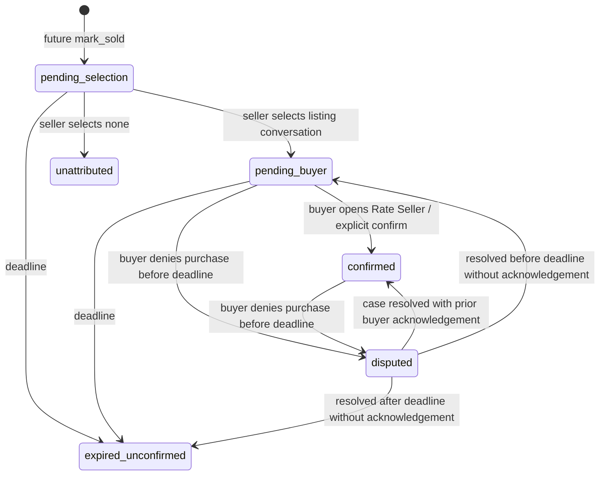

# Ratings V1 backend contract

Candidate, 26 October 2026. Backend only; no hosted changes or consumer activation.
Observed local base HEAD: `213b57c84e2b3767e3ab3499846dd280bf3315c3` on `main`.
No fetch/pull or synchronization was authorized. Existing local work is inventoried in
`releases/candidates/ratings-v1/starting-checkout.json`. The initial candidate adds five
CLI-generated forward migrations. Consumer-contract completion adds
`20261026094908_ratings_consumer_contract.sql` after those five, independently of
Chat V2 PR #58. No initial migration bytes are changed. Separate release delta:
`releases/candidates/ratings-v1-contract-fix/`.

## Constants and eligibility

The server owns the 14-day window, faces 1..4, 500 Unicode codepoints after NFC
normalization, up to five unique validated tag codes, and score threshold three.
All four private settings (`enabled`, `public_reads`, `jobs_enabled`, `staff_enabled`)
start false. No client or service-role settings grants. No new environment variables.
The existing Auth identity, active-account check and sold RPC's current-policy
acceptance gate remain authoritative. No phone/email verification or account-pair
restriction is added. Repeated mutually acknowledged transactions count across
distinct listings, irrespective of how recently the same pair traded.

Every existing/new profile has a zero stats row. No old sold listing is backfilled.
Only future sold transitions while `enabled` is true produce pending trades. Turning
the flag off also stops new sold-trigger trade capture. Existing legacy
`seller_transition_listing(listing_id uuid, action text) -> jsonb` is unchanged,
including response, status guards, legal acceptance, grants and audit behavior.
The additional sold trigger creates only a `pending_selection` trade. Ratings API
cannot attach a buyer to a historical sold listing without an existing trade.

## State transitions

`voided` and `risk_excluded` are private eligibility controls, absent from consumer
DTOs. Voiding is final in V1. Resolving a dispute cannot invent buyer acknowledgement.
Disputes freeze submissions, suppress public reviews and remove completed/countable
reputation until resolution. Quick dispute closes exactly at the deadline; existing
formal support/report APIs remain available afterward. Void prevents publication and
counting. Risk exclusion prevents counting, while otherwise visible published content
can remain visible. A fraud-related tag is an internal signal, never proof of fraud.

Marking sold is atomic with trade creation/selection and typed events. Selection is
by **conversation ID**, never a buyer UUID. The conversation must belong to the listing
and seller, have an active buyer, and not be self-chat. One unique trade per listing;
once selected the buyer cannot be replaced. `pending` means “Not now”; `none` closes
unattributed and does not permit ratings. Selection never extends the original window.

Consumers MUST call `ratings_buyer_action(trade_id,'confirm')` when opening Rate Seller,
before rendering the optional review wizard. Confirmation persists if the wizard is
abandoned. Buyers cannot submit until confirmed. Sellers may submit while buyer is
pending. Completed trades require seller acknowledgement through sold/selection plus
explicit buyer acknowledgement; zero submitted reviews is valid.

## Write RPCs

All public RPCs use `SECURITY INVOKER SET search_path=''` over private definer
implementations. Only `authenticated` receives these grants. Every user mutation
validates `auth.uid()` and active account status. Service credentials are not part of
the client contract. Parameter names below are exact PostgREST JSON keys.

| Signature | Request and response |
| --- | --- |
| `ratings_sell(listing_id uuid, choice text='pending', conversation_id uuid=NULL) -> jsonb` | `choice`: `select`, `pending`, `none`. `select` requires conversation; others require NULL. Returns `{trade_id:uuid,state:TradeState,deadline:timestamp}`. Calls existing sold implementation for unsold listing, preserving allowed statuses active/reserved/paused and current-policy acceptance. |
| `ratings_buyer_action(trade_id uuid, action text) -> jsonb` | `confirm` or `dispute`; selected buyer only, before deadline. Returns `{trade_id:uuid,state:'confirmed'|'disputed'}`. |
| `ratings_submit(trade_id uuid, communication integer, payment_item integer, meetup integer, body text=NULL, tags text[]='{}') -> uuid` | Required raw integer faces 1..4. Returns immutable review ID. Recipient and reviewer role are derived server-side. |
| `ratings_reply(review_id uuid, body text) -> uuid` | Recipient only; published, visible, nonvoid review with written body required. One permanent nonblank reply. Returns review ID. |
| `ratings_report(review_id uuid, reason text) -> uuid` | Visible published review only; cannot report own review. Reason 3..500 normalized codepoints. One report per reporter/review; ten new cases per rolling day. Returns private case ID; creates existing safety support ticket. |

Repeated identical sell/confirm/dispute calls do not create duplicate rows. Review and
reply retries with identical normalized text/faces/tags return the same ID; changing
any immutable value fails. Tag order matters to exact replay. Submissions and buyer
actions after deadline fail even if an earlier identical request succeeded. Clients
recover uncertain late retries through private reads. Domain writes are serialized by
a private transaction advisory lock, taken after the listing lock for sold operations.
Aggregates recompute only the affected profiles in the same transaction. No network
or worker operation is inside that transaction. V1 favors correctness over concurrent
write throughput; load qualification remains a release gate. Retry whole idempotent
requests on SQLSTATE `40P01`/`40001`, including privacy/listing lock contention.

## Faces, tags and text

Seller reviews buyer: Communication / Payment / Meeting-pickup.
Buyer reviews seller: Communication / Item-as-described / Meeting-handover.
The stable storage/API names are `communication`, `payment_item`, `meetup`.
Faces: 1 Poor, 2 Fair, 3 Good, 4 Excellent.

Database generated score:
`round((((communication + payment_item + meetup) / 3.0) - 1) / 3.0 * 10, 1)`.
`1,1,1=0.0`; `3,3,4=7.8`; `4,4,4=10.0`. TypeScript score is reference only.

All text is NFC, trimmed of ASCII outer spaces, max 500 codepoints (not UTF-16 code
units). NULL/empty review body means no written text. Reply and report reason require
nonempty text. Reject C0/C1 controls, angle brackets and bidi overrides/isolates/BOM.
Store/render as plain text; consumers must use escaped text nodes, never HTML parsing.
The same validator covers body, reply and case reason; no external payment instructions
or links can appear in server-generated event/notification templates.

| Reviewer role | Enabled initial tags |
| --- | --- |
| Both | `on_time`, `polite`, `quick_replies`, `did_not_show_up`, `sent_payment_link` |
| Seller | `paid_as_agreed`, `easy_pickup`, `delayed_payment` |
| Buyer | `item_as_described`, `accurate_photos`, `smooth_handover`, `item_not_as_described`, `changed_price`, `asked_advance_payment` |

Private `rating_tags` vocabulary is extensible by a reviewed server migration.
`asked_advance_payment` and `sent_payment_link` are internal signals removed from all
review DTO tag projections. Tags do not automatically change eligibility.

## Publication and aggregates

Authors see their own sealed submission in Given. Received and public projections
contain no counterpart review until both submit or the deadline passes. Publication
is independent of trade confirmation: seller-only review can publish on expiry, but
unconfirmed trade adds zero counted reputation and zero completed trades.

Private `publish_due_reviews() -> integer` processes up to 200 due trades per call,
sets terminal closure metadata, publishes eligible submitted reviews and emits one
expired event. Repeated runs are idempotent. Missing submission is derived as
`not_rated` in trade state. Pending actions/count exclude expired trades immediately,
even if the scheduler has not run. Reviews become public only on publication, so
publication can lag the deadline by the job cadence/backlog. Disputed reviews stay
sealed/suppressed until authorized case resolution; resolution republishes due content.

`profile_rating_stats` stores published visible nonvoid/nondisputed review count,
counted review count, mutually acknowledged valid completed trades, profile score,
three dimension averages. Counted reviews additionally require a confirmed trade,
buyer acknowledgement and no risk exclusion/redaction. Profile score is the arithmetic
mean of the stored individual review scores, rounded to one decimal. Raw dimension
averages are 1..4, rounded to two decimals. Below three counted reviews score and
dimension averages are NULL. `score=0.0` is valid and `display_state='rated'`; consumers
must test NULL, never truthiness. There are no paid ratings/badges/boosts.

## Read RPCs and schemas

All page sizes are fixed **20**, ordered descending by timestamp then UUID. Supply
both `before_at` and `before_id` from `next_cursor`, or neither. Envelope:
`{items:T[], has_more:boolean, next_cursor:{before_at:timestamp,before_id:uuid}|null}`.
Maximum 21 rows are read for lookahead. Timestamps use RFC3339 offsets; UUID tuple
comparison breaks timestamp ties. Cross-request mutations may remove rows, but the
immutable ordering tuple avoids duplicate page rows. No page read changes state.

| Exact signature | Row schema / authorization |
| --- | --- |
| `ratings_buyer_candidates(listing_id uuid,before_at timestamptz=NULL,before_id uuid=NULL) -> jsonb` | Seller only. `{id:conversation_uuid,buyer_id:uuid,display_name:text,created_at:timestamp}`. Own listing's active buyers only. |
| `ratings_pending(before_at timestamptz=NULL,before_id uuid=NULL) -> jsonb` | Current active user only. `{id:trade_uuid,listing_id:uuid|null,sold_at:timestamp,deadline:timestamp,state:TradeState,action:'select_buyer'|'confirm_and_rate'|'rate'}`. Submitted reviews remove own action. |
| `ratings_given(before_at timestamptz=NULL,before_id uuid=NULL) -> jsonb` | Current active author's reviews, including their sealed review. Review DTO below. |
| `ratings_received(before_at timestamptz=NULL,before_id uuid=NULL) -> jsonb` | Current active recipient, published visible reviews only. Review DTO. |
| `ratings_public_reviews(user_id uuid,before_at timestamptz=NULL,before_id uuid=NULL) -> jsonb` | `anon`/`authenticated`; `public_reads` flag required. Active recipient only; absent/nonactive returns empty page. Review DTO. |
| `ratings_events(trade_id uuid,before_at timestamptz=NULL,before_id uuid=NULL) -> jsonb` | Active trade participant only. `{id:uuid,trade_id:uuid,kind:TradeEvent,created_at:timestamp}`. |
| `ratings_summary(user_id uuid) -> jsonb` | `anon`/`authenticated`; `public_reads` required; NULL for absent/nonactive. `{user_id:uuid,published_review_count:int,counted_review_count:int,completed_trades:int,score:number|null,communication_average:number|null,payment_item_average:number|null,meetup_average:number|null,display_state:'rated'|'no_rating_yet'}`. |
| `ratings_pending_count() -> integer` | Current active user's total outstanding actions, unpaginated count, including buyer selection. |
| `ratings_trade(trade_id uuid) -> jsonb` | Active participant only. `{id:uuid,listing_id:uuid|null,conversation_id:uuid|null,state:TradeState,deadline:timestamp,buyer_confirmed:boolean,can_dispute:boolean,my_review_id:uuid|null,my_rating_status:'submitted'|'not_rated'|'pending'}`. |
| `ratings_trade_for_conversation(conversation_id uuid) -> jsonb|null` | Active actual conversation participant AND trade participant only. Same Trade DTO as `ratings_trade`, including pending, confirmed, submitted/rated, disputed and expired trades. Existing conversation with no matching selected trade returns JSON null; missing/foreign conversation always `42501 RATINGS_ACCESS_DENIED`. Seller can retrieve an unselected `pending_selection` trade through their listing conversation; an unselected enquirer receives null. A submitted review is represented by `my_rating_status='submitted'`, not a new trade state. |
| `ratings_given_history(before_at timestamptz=NULL,before_id uuid=NULL) -> jsonb` | Active current user only, enabled required. Typed Given-history entries below; existing `ratings_given` remains review-only. |

Review DTO (all keys present): `{id:uuid,author_id:uuid|null,recipient_id:uuid|null,
reviewer_role:'buyer'|'seller',communication:int,payment_item:int,meetup:int,score:number,
author_display_name:text|null,recipient_display_name:text|null,context:RatingContext,
body:text|null,tags:string[],submitted_at:timestamp,published_at:timestamp|null,
reply:{body:text,created_at:timestamp}|null}`. Author ID is NULL for nonactive author.
Recipient ID and each display name are also NULL when that identity is not active.
`RatingContext` is `{trade_id:uuid,listing_id:uuid|null,listing_title:text,sold_at:timestamp}`.
Only active/reserved/sold listings with an active seller supply ID/title; otherwise
`listing_id=null,listing_title='Listing removed'`. No historical title snapshot,
description, location, price, contact information or media is disclosed. `reviewer_role`
identifies the author's buyer/seller role; the recipient has the opposite role. Render
names/title/body as escaped plain text. New DTO keys require consumers using strict
Zod validation to adopt the updated schema before activation.
Private author DTO may show their own hidden submission; redacted text is never
returned. Public profile route stays `/seller/{userId}`. No handles or contact fields.
Client boundary schemas/reference calculation are under `src/lib/ratings/`.

Given-history entry is a discriminated union (no mixed nullable review fields):

- `{kind:'review',id:review_uuid,at:submitted_at,review:ReviewDTO}`
- `{kind:'not_rated',id:trade_uuid,at:deadline,context:RatingContext,my_role:'buyer'|'seller'}`

Not-rated entries require a selected buyer/seller, nonvoid trade, expired deadline,
and no own submission. They include disputed and unconfirmed expired transactions;
unattributed and never-selected trades are excluded. They appear immediately at the
deadline, even before scheduler processing. They reveal no counterpart submission ID,
existence, text, faces, tags or publication time. No synthetic review or reputation is
created. Pagination is 20 entries plus one lookahead, descending `(at,id)` where review
`at=submitted_at` and not-rated `at=deadline`; use the envelope cursor unchanged.
No 90-day filter, new phone/OTP requirement or historical backfill is introduced.

## Chat and notifications

Dedicated protected `trade_system_events` is authoritative; legacy messages are
unchanged. Fixed kinds: `buyer_selected`, `pending_buyer`, `confirmed`, `rated_buyer`,
`rated_seller`, `disputed`, `expired`. Events contain only IDs, kind and timestamp.
Clients fetch a separate projection, never infer official cards from message content.
There is no `system_trade` insert API, event body, external URL, UPI request or OTP
instruction. Event pagination is separate from Chat V2 messages; do not intermix the
two cursors. Trade state supplies card actions. Buyer-selection events exist only in
the selected conversation's trade and are never visible to other enquirers.

Notification generation uses existing `create_notification`, existing account-status
rules and fixed internal `/account/ratings` link. V1 reuses existing enum `support_reply`
to avoid changing a shared notification enum/old consumers; compatible consumers must
route by link until a separately coordinated notification type is introduced.
Buyer selection/confirm-and-rate is one notification, seller pending rating is another.
Day 3 and day 10 reminders apply only to outstanding rate/confirm actions. Select-buyer
actions are not reminded. Private receipts deduplicate per trade/user/kind transactionally
with the notification insert. Latest due reminder wins when delayed beyond day 10;
old day-3 notification is not sent late. Both initial and reminder infrastructure require
`enabled AND jobs_enabled`. Private reminder cursor batches 200 trades and cycles,
avoiding permanently starving older outstanding actions. Completion removes future
reminders; delivered notifications remain ordinary account history.

## Staff, reporting and privacy

`admin_ratings_case(case_id uuid,action text,reason text) -> jsonb` and
`admin_ratings_ticket(ticket_id uuid,action text,reason text) -> jsonb` require active
moderator/administrator, JWT AAL2, separate `staff_enabled` and reason 3..500 codepoints.
The ticket RPC resolves only an existing case linked to the supplied support ticket.
Staff cannot operate on their own trades/reports. No existing Admin grants are restored.

`admin_ratings_cases(kind text,status text='open',before_at timestamptz=NULL,before_id uuid=NULL)
-> jsonb` is the metadata-only queue. Kind is required `review_report` or `dispute`;
status is `open`, `resolved` or `all`, based on `resolved_at`. Active moderator or
administrator, JWT AAL2 and `staff_enabled` are all required. Conflicted rows (own
trade or report) are omitted, including NULL-safe checks for erased identities.
Same fixed 20-row envelope/cursor, descending `(created_at,id)`. Exact queue row:
`{id,trade_id,review_id:null|uuid,support_ticket_id:null|uuid,kind,created_at,resolved_at:null|timestamp}`.
No reason, reporter/participant identities, review content, listing details, sealed
evidence or eligibility flags appear. Queue navigation creates no evidence-read audit;
detailed reads still require the case-scoped, reason-required audited `evidence` action.
All new RPCs grant only authenticated EXECUTE; no table grants or existing staff/export
permissions are broadened. Public wrappers remain invokers with private definers.

Actions: `evidence`, `hide`, `restore`, `resolve`, `void`, `exclude`, `clear_exclusion`.
Hide/restore requires a review-report case. Resolve requires disputed nonvoid trade;
prior buyer acknowledgement is required for confirmed state. Every action including
evidence reads appends an audit record. Mutations return `{case_id:uuid,action:text}`.
Evidence returns `{case:RatingCase,trade:InternalTrade,reviews:InternalReview[],replies:InternalReply[]}`
and is the only DTO containing sealed evidence/internal eligibility controls.
`RatingCase`: `id,trade_id,review_id|null,reporter_id|null,support_ticket_id|null,kind,
reason,created_at,resolved_at|null`. `InternalTrade`: `id,listing_id|null,seller_id|null,
buyer_id|null,conversation_id|null,state,sold_at,deadline,buyer_confirmed_at|null,
closed_at|null,voided,risk_excluded`. `InternalReview`: Review storage fields including
`trade_id,author_id,recipient_id,reviewer_role,communication,payment_item,meetup,score,
body,tags,submitted_at,published_at,hidden,redacted,id`; `InternalReply`:
`review_id,author_id|null,body,created_at`. Reasons/evidence never enter public APIs.

Existing privacy export implementation is renamed to private `ratings_export_base`;
the wrapper calls it first, retaining authorization, audit, original data and installed
ACLs. It appends `ratings:{given:OwnSubmission[],received:ReviewDTO[],replies:OwnReply[],trades:OwnTrade[]}`.
OwnSubmission has review ID/trade ID/role/faces/score/body/tags/submission/publication
times, never counterpart sealed content. OwnTrade contains only ID/listing/state/sold/
deadline/buyer-confirmation timestamps; OwnReply has review ID/body/creation time.

Logical `deletion_pending`/`deleted` and physical Auth deletion both invoke erasure:
erase free text/tags involving the account, tombstone replies, null subject identifiers,
void affected trades, delete notification receipts and recompute affected reputations.
This conservatively removes both counterpart and deleted user's related reputation.
Minimal case/audit evidence is retained under the existing compliance-record model;
reporter free text is redacted and its identity nulled. Staff audit reasons remain
immutable retained evidence, matching existing audit policy; no new retention duration
is invented. Auth FKs use SET NULL; profile stats cascade. Erasure works with flags OFF.
Any future migration that replaces privacy exporter must preserve this wrapper chain;
profile-onboarding may precede Ratings, but is not a prerequisite. Do not overwrite its
unmerged SQL or helper names. Release preflight must capture exporter definition/ACLs.

## Errors

| SQLSTATE | Message / meaning |
| --- | --- |
| `42501` | `RATINGS_ACCESS_DENIED`, `RATINGS_STAFF_CONFLICT` — no authorized identity/ownership/role/AAL2, or staff conflict. Missing and forbidden objects deliberately share denial. |
| `55000` | `RATINGS_DISABLED`, `RATINGS_STAFF_DISABLED`, `RATINGS_LEGACY_SOLD`, `RATINGS_WINDOW_CLOSED`, `RATINGS_TRADE_FROZEN`, `RATINGS_CONFIRM_FIRST`. |
| `22023` | `RATINGS_INVALID_CHOICE`, `RATINGS_INVALID_BUYER`, `RATINGS_INVALID_ACTION`, `RATINGS_INVALID_FACES`, `RATINGS_INVALID_TAGS`, `RATINGS_INVALID_TEXT`, `RATINGS_INVALID_CURSOR`, `RATINGS_INVALID_PAGE`, `RATINGS_REASON_REQUIRED`, `RATINGS_CASE_MISMATCH`. |
| `23505` | `RATINGS_TRADE_CONFLICT`, `RATINGS_REVIEW_IMMUTABLE`, `RATINGS_REPLY_IMMUTABLE`; uniqueness defense also applies at table level. |
| `54000` | `RATINGS_REPORT_LIMIT`. |

Existing sold RPC errors/SQLSTATE, including `POLICY_ACCEPTANCE_REQUIRED:`, remain
unchanged. Standard PostgreSQL type errors reject fractional integer RPC inputs.
Do not disclose internal eligibility reasons to consumers. Clients should show generic
unavailable/frozen state, not infer fraud. Retryable lock/transaction errors are standard
PostgreSQL `55P03`, `40P01`, `40001`; retry complete idempotent operations, never partial SQL.

## Release and verification references

Separate staged/production manifests, environment identity guards, inactive scheduler
setup, dependency order, rollback, receipt template and exact check evidence are in
`releases/candidates/ratings-v1/`. Historical 58 files/hash manifest remain untouched.
Native SQL tests use PostgreSQL 17; PGlite is supplementary, not hosted acceptance.
CI wiring is a proposed snippet for ChatGPT; this task makes no Actions changes.

Documentation checked 26 October 2026: [RLS](https://supabase.com/docs/guides/database/postgres/row-level-security),
[database functions / safe search paths](https://supabase.com/docs/guides/database/functions),
[Cron](https://supabase.com/docs/guides/cron/quickstart),
[Postgres upgrades and compatibility](https://supabase.com/docs/guides/platform/upgrading),
[changelog](https://supabase.com/changelog.md). The implementation uses ordinary
Postgres 17-compatible functions, generated columns, row locks and advisory locks.

## Automated launch acceptance handoff (27 October 2026)

Acceptance source baseline: Backend main `c53b956eb2d34858e007580678ec5f04814f1b76`.
The preceding candidate provenance is historical. This change adds no migrations,
API/RLS grants, dependencies, runtime flags or CI workflow changes.

### Secure hosted Test run

Invoke `node tests/ratings/auth-test-only.mjs` only in a trusted operator process
with credentials injected by its secret store (never shell arguments, chat, files,
logs, CI artifacts or browser bundles). No environment files are loaded.

Both modes require `RATINGS_AUTH_TARGET=FairSwapTest`, `RATINGS_AUTH_URL` equal to
`https://wpppxlnbzqynvhpeuavd.supabase.co`, and `RATINGS_AUTH_PUBLISHABLE_KEY`
(Test publishable key or project-bound legacy anon key). Privileged keys are rejected;
legacy keys with another project ref fail before any request. Opaque publishable keys
cannot be project-validated locally; the exact Test endpoint validates them server-side.

Default mode (or `RATINGS_AUTH_MODE=tokens`) accepts the existing inputs:
`RATINGS_AUTH_SELLER_TOKEN`, `RATINGS_AUTH_BUYER_TOKEN`, `RATINGS_AUTH_OUTSIDER_TOKEN`,
`RATINGS_AUTH_STAFF_AAL1_TOKEN` and `RATINGS_AUTH_STAFF_AAL2_TOKEN`.
Use five distinct short-lived access tokens for four distinct active users, with the
same active moderator/administrator at AAL1 and AAL2. Tokens need more than 60 seconds
remaining. This mode does not create sessions or prove live MFA challenge completion.

Opt in to existing-account login with `RATINGS_AUTH_MODE=password-totp`. Supply
`RATINGS_AUTH_{SELLER,BUYER,OUTSIDER,STAFF}_{EMAIL,PASSWORD}`,
`RATINGS_AUTH_STAFF_FACTOR_ID` and `RATINGS_AUTH_STAFF_TOTP_SECRET` through the same
secure operator environment. All required inputs are checked before SDK creation or
HTTP. Use four authorized active Test accounts, an existing moderator/administrator
assignment and that staff account's existing verified TOTP factor. No staff-role
provisioning, account creation/modification, MFA enrollment or service key is used.
The pinned Supabase SDK signs in each account with its password, retains the staff
AAL1 bearer, then lists factors, challenges and verifies TOTP on the same client.
The acquired bearers pass the unchanged Auth/PostgREST acceptance matrix. Token
persistence, automatic refresh and URL session detection are disabled; SDK requests
reject redirects and have a 15-second timeout. Passwords, TOTP seeds and SDK payloads
never enter returned errors or receipts.

Every created client is signed out with `scope: 'local'` in a finally block, including
when acceptance fails; a cleanup error fails the run. Local-scoped sign-out revokes
that session's refresh token and does not instantly invalidate an already issued
access JWT: it may remain usable until expiry. It does not globally sign out other
sessions. No enrolled factor is removed or changed.

Decoded JWT claims remain untrusted preflight filters; unchanged bearers must pass
Auth user validation and actual PostgREST authorization. The runner preserves Test
issuer, audience, role, subject/session, expiry, distinct-identity and staff AAL checks.
It verifies invalid-token rejection by Auth and PostgREST, 25 direct-table GET denials,
disabled participant RPCs and staff role/AAL/disabled boundaries. SQLSTATE `55000`
requires HTTP 500; authenticated `42501` staff denials require HTTP 403. A pass
returns counts only. The runner does not read private settings or prove all four
flags/cron state; independently targeted monitoring must confirm those. Seller/buyer
labels do not prove transaction ownership without fixtures. Keep enabled-state writes
outside this runner. No Production Auth operation is supported.

Focused offline verification:
`node --test tests/ratings/auth-sessions.test.mjs tests/ratings/auth-test-only.test.mjs`.
Hosted execution requires all secure operator inputs; otherwise report
**NOT RUN — CREDENTIALS UNAVAILABLE**. Integration and protected CI remain with ChatGPT,
followed by Test → Production verification with Ratings disabled. Rollback is a
protected Git revert; preserve all migration and audit history.

### Disposable scenarios and automated evidence

`node --test tests/ratings/auth-test-only.test.mjs` uses fake unsigned tokens and a
network-blocking guard. It is offline regression evidence, never hosted acceptance.
`node tests/ratings/run.mjs` runs supplementary PGlite. Use
`tests/ratings/run-native.ps1` on Windows or `tests/ratings/run-native.sh <absolute-bin>`
on Linux for a fresh loopback PostgreSQL 17 cluster. Auth, cron and notification
infrastructure remain fixtures even in native PG17. No connection URL is accepted.
The existing suite covers sealed/immutable reviews, threshold three, reports,
disputes, AAL2, own-case conflicts, audited evidence and privacy erasure. Launch
checks add batch-205 draining, delayed day10-over-day3 delivery, notification-insert
failure with transactional receipt rollback, exact retry deduplication, monitoring
SQL execution and repeatable rollback fingerprinting all trade/review/reply/event,
case/audit/receipt history while preserving unrelated jobs. Notification inserts
are not proof of external delivery. Real cron execution/throughput, notification
provider delivery and operational response remain separately unverified.

Local execution: 4 Auth regression tests, 7 contract tests, 52 supplementary
PGlite checks (PostgreSQL 18.3 WASM), 93 unit tests, 83 existing moderation regressions,
195 CI-validator tests, 6 release-contract tests and 6 Production-category verifier
tests passed. Typecheck, migration-byte integrity (58 historical files), unit
network-isolation pins, branding and Ratings DTO compilation passed. A second
isolated worktree with canonical LF bytes resolved initial Windows CRLF integrity
failures; Git Bash on the process PATH resolved validator shell startup failures. Hosted Test: **NOT RUN — CREDENTIALS
UNAVAILABLE** (no required operator variables present). Native PG17 startup was
blocked by the installed distribution missing `share/postgres.bki`; no PG17 pass is
claimed. Protected Linux CI must run native PG17 and all existing aggregate gates.

### Monitoring, release order and rollback

ChatGPT integrates the exact diff into its prepared branch, preserves existing CI
(including `backend-ci-success`), and runs protected CI before Test acceptance, then
applicable Production source/config delivery. No schema deployment is required.
Keep all four database settings false and both Ratings cron jobs inactive in Test
and Production. Enabled-state qualification stays in disposable databases unless
isolated hosted Test automation is independently authorized. Never create synthetic
Production trades. Credentials must be injected by a secure operator; never request
their values in chat. Public launch remains blocked by hosted identity acceptance,
operational ownership, editorial approvals and native parity/scope signoff.

Separately targeted runtime configuration names (values intentionally omitted): Web
server-only `FAIRSWAP_RATINGS_V1_ENABLED`, `FAIRSWAP_RATINGS_PUBLIC_SCORE_ENABLED`;
Admin environment-specific flags must be confirmed from its own repository before
any deployment (this Backend scope does not establish their names). Database
`app_security.ratings_settings`: `enabled`, `public_reads`, `jobs_enabled`,
`staff_enabled`; cron `ratings-v1-publication`, `ratings-v1-reminders`. This task
changes none of these. Independently verify Test/Production project identities.

Run `tests/ratings/launch-monitoring.sql` as a separately authorized read-only
operator against each verified project. Collect aggregate output only. Alert on
publication lag over 600 seconds, missing jobs, any failed/stalled job, duplicate
receipt keys, impossible scores or threshold configuration drift. Compare backlog
across timestamped receipts for growth; SQL alone does not install an alert sink.
Receipt uniqueness does not prove absence of duplicate external notifications.
Monitor both case kinds and audit counts; zero audit actions alone is not an audit
gap. Reconcile authorized case operations with immutable audit records in the
operational system and assign grievance/on-call ownership and response thresholds.
Do not expose case reasons, identities, JWTs, review content or raw cron errors.

Production owner checks after applicable deployment: flags/cron remain OFF,
publication lag/backlog, reminder duplication, NULL score below three counted
reviews and valid 0..10 score at threshold, moderation queues/audit and errors.
Use automated monitoring; no owner manual testing is required before deployment.
Rollback source through a protected PR and prior app deployment as applicable;
keep all four flags false and both Ratings jobs inactive. Preserve all data, audit,
receipts and migration history. Do not delete trades or reverse historical SQL.

### Challenge-time Auth input and hosted acceptance blockers (28 October 2026)

Patch base: `8a30e77df131a8db338651a2033839047052857c`, isolated detached checkout;
the existing dirty Backend checkout is preserved. No commits, remote writes,
deployments, credential changes or hosted mutations were performed.

Secure input names only: `RATINGS_AUTH_TARGET`, `RATINGS_AUTH_URL`,
`RATINGS_AUTH_PUBLISHABLE_KEY`, `RATINGS_AUTH_MODE`,
`RATINGS_AUTH_SELLER_EMAIL`, `RATINGS_AUTH_SELLER_PASSWORD`,
`RATINGS_AUTH_BUYER_EMAIL`, `RATINGS_AUTH_BUYER_PASSWORD`,
`RATINGS_AUTH_OUTSIDER_EMAIL`, `RATINGS_AUTH_OUTSIDER_PASSWORD`,
`RATINGS_AUTH_STAFF_EMAIL`, `RATINGS_AUTH_STAFF_PASSWORD`,
`RATINGS_AUTH_STAFF_FACTOR_ID`, `RATINGS_AUTH_STAFF_TOTP_SECRET`,
`RATINGS_AUTH_STAFF_TOTP_MODE`, `RATINGS_AUTH_STAFF_TOTP_CODE_FD`.
Existing bearer mode retains `RATINGS_AUTH_SELLER_TOKEN`,
`RATINGS_AUTH_BUYER_TOKEN`, `RATINGS_AUTH_OUTSIDER_TOKEN`,
`RATINGS_AUTH_STAFF_AAL1_TOKEN`, `RATINGS_AUTH_STAFF_AAL2_TOKEN`.

Password Auth mode remains `password-totp`. TOTP input mode defaults to `seed`;
opt into `code` to supply one six-digit code through an inherited pipe descriptor
3..255. Do not supply a seed in code mode. Preflight checks all other inputs and
the open pipe before SDK creation. After successful staff challenge creation, a
fixed, identity-free readiness message tells the trusted pipe writer to supply
the code. Reading is bounded to 30 seconds and eight bytes including line ending;
there is one verification attempt, no enrollment, refresh or automatic retry.
The trusted writer must close its end and must not prefill a stale code. Do not
use argv, echoed terminal input, files, chat or artifacts for codes. In an embedded
operator runtime, the optional code-supplier callback receives only an abort signal
at the same stage; it must honor cancellation. The acceptance callback receives
only target/URL/publishable key and the five issued bearer tokens, never passwords,
emails, factor IDs, TOTP seeds, code inputs or the inherited environment.
Server verification and the unchanged Auth/PostgREST matrix establish acceptance;
reading a code or decoding a JWT does not establish AAL2. Local sign-out does not
immediately invalidate already-issued access JWTs. CLI preflight failure exits 2
with NOT RUN; failures after preflight exit 1 with sanitized FAIL output.

Hosted Auth: **NOT RUN**, no `RATINGS_AUTH_*` operator inputs available. Hosted
direct-write denials also remain unverified; the existing 25 hosted-matrix denials
are direct reads. No genuine hosted JWT or AAL2 receipt is claimed.

Hosted enabled-state runner: **BLOCKED / NOT RUN; not introduced**. Existing
publication/reminder jobs process a global backlog. The disposable PG17 fixtures
create Auth users, grant staff membership and install a notification-failure
trigger; they cannot be replayed on hosted Test accounts. A process `finally` or
signal handler cannot guarantee OFF restoration after forced termination, nor
prevent global jobs from touching nonfixture trades. Secure participant consent,
dedicated fixture IDs and an independently enforced expiring isolation mechanism
are unavailable. An unconditional global activation runner would violate the
fixture-isolation and interrupted-process recovery requirements of PR #61's work
order. No hosted enabled-state acceptance is complete in this patch.

Separate additive migration proposal, **not implemented or applied**: a Test-only
acceptance lease and fixture allowlist, checked against the exact project inside
every enabled worker path, with hard database-time expiry and independently
scheduled OFF recovery. Enable and force RLS on private lease/fixture tables;
revoke all client/public access, use explicit least-privilege operator grants and
private empty-search-path functions. Preserve existing RLS and production worker
behavior. Review locking against concurrent sold capture, fixture-only restoration
of derived scores/notifications and crash recovery before approving this design.
Until that contract is reviewed and verified, reuse the existing native suite.
Later hosted automation must observe real `cron.job_run_details`, persisted in-app
rows and authenticated recipient/outsider reads, genuine staff AAL2 operations,
retry/deduplication, publication, moderation and fixture-limited cleanup. Never
substitute SQL role settings, forged JWTs or direct worker calls for those proofs.

Ratings notifications are **in-app only**, through `create_notification` into
`public.notifications`, with `support_reply` and `/account/ratings`. No external
WhatsApp/SMS/email provider was added or tested. Aggregate monitoring now also
alerts when an active Ratings cron has no run started within ten minutes; inactive
jobs do not alert. SQL monitoring is not an installed alert route. A genuine
on-call owner and alert sink remain a separate protected task and acceptance gap.

File inventory: `tests/ratings/auth-sessions.mjs`, `auth-sessions.test.mjs`,
`auth-test-only.mjs`, `auth-test-only.test.mjs`, `launch-readiness.mjs`,
`launch-monitoring.sql`, and this contract. No migrations or CI changes.

Automated evidence from this isolated patch: Node 24.15.0; 19 offline Auth tests
(including inherited-pipe timing, timeout/abort, cleanup, redaction and the unchanged
42-request acceptance matrix); 7 contract tests; 52 supplementary PGlite checks;
54 native PostgreSQL 17.6 checks. Native cluster shutdown and fixture-directory
cleanup completed. Native Auth/JWT/cron remain fixtures. Migration verifier passed
58/58 after restoring canonical Git blob bytes for the clone's CRLF-converted
immutable files; no migration diff. Typecheck and all 93 existing network-blocked
unit tests passed. Initial missing dependencies,
Windows sandbox initdb/esbuild restrictions and a CRLF-sensitive new monitor-test
selector were resolved before the passing checks. Hosted checks have no PASS receipt.

ChatGPT integrates via protected GitHub CI, Test first, then Production source and
read-only verification. All Ratings gates remain OFF pending final launch approval.
After later activation, monitor threshold-three scores, reminder duplication,
publication lag, moderation queues and fraud reporting. Rollback returns Test
settings/jobs to OFF, restores only isolated fixtures and uses protected Git revert;
preserve real account, audit and migration history. No owner manual test gate.
